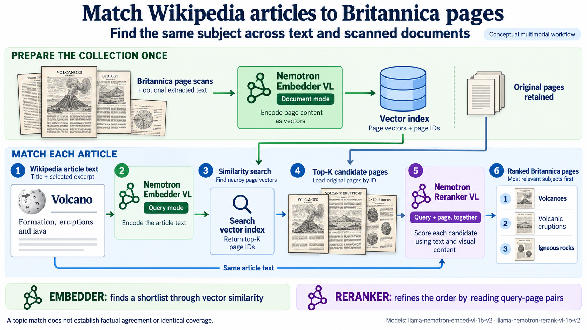

# Nemotron Agentic AI Challenge

Build an agent that compares historical Britannica pages with Wikipedia.
Work with your coding agent to complete the project stages.

## Our solution

This repository completes all six stages for the 100 pinned Britannica scans.
The submission record is in [templates/submission.md](templates/submission.md).

| Item | Value |
| --- | --- |
| Team | Dhaubaji (Prabesh Shrestha and Saroj Maharjan) |
| Repository | <https://github.com/prabeshsb/nemotron-agentic-ai-challenge>, branch `main` |
| Website | <https://prabeshsb.github.io/nemotron-agentic-ai-challenge/> |
| Scan pages and PDFs | <https://prabeshsb.github.io/nemotron-agentic-ai-challenge/scans.html> |
| Video | [dhaubaji-video.mp4](https://github.com/prabeshsb/nemotron-agentic-ai-challenge/releases/download/video-v1/dhaubaji-video.mp4), script in [docs/video-script.md](docs/video-script.md) |

### How the pipeline works

1. **Extract.** Parse 3.5 reads each scan. The code splits the page text into Britannica entries and keeps page IDs, block IDs, boxes and scan checksums.
2. **Match.** Super VL proposes Wikipedia titles for each entry. The Wikipedia API and BM25 search supply candidates. The Nemotron embedder and reranker score the candidates. Thresholds accept, flag (`uncertain`) or reject (`no_match`) the best candidate.
3. **Compare.** The code normalises old spelling, measures shared vocabulary, finds distinctive words, builds joint topics, and asks Super VL for fact claims. It checks each claim quote against both saved texts.
4. **Agent.** Hermes Agent with Super VL answers questions through five tools over the saved evidence. It can check a scan crop with `vision_analyze`.
5. **Site.** The code writes one LuaLaTeX document and one HTML page per scan, plus analysis and agent pages.
6. **Evaluate.** The code writes the reviewed success and failure cases, the match calibration and a reproducibility record.

Each stage reads the saved output of the stage before it.
No stage invents a result for a failed model call. Failed calls stay in the records with their errors.

| Stage | Method | Result |
| --- | --- | --- |
| Extract | Parse 3.5 reads the full page for layout. It then reads masked column crops at 3x and full-width tiles at 2x. | 100 pages: 88 text, 9 plates, 2 covers, 1 blank. 284 entries: 201 headwords, 83 continuations. |
| Match | Super VL proposes Wikipedia titles and keywords for each entry. The live Wikipedia API maps titles to page IDs. BM25 adds keyword candidates. The embedder orders all candidates and the reranker scores the best 32. Calibrated thresholds accept, flag, or reject the best candidate. | 340 targets. Topic: 202 accepted, 60 uncertain, 22 no match. Subtopic: 17, 26, 13. 279 articles. |
| Compare | Long-s and spelling normalisation with a record of each change. Vocabulary lift against unrelated articles. Distinctive words by log-odds. Joint topics with Nemotron embeddings, UMAP, HDBSCAN and c-TF-IDF. Super VL fact claims with quotes checked in both sources. | 219 pairs, median lift 2.541. 637 fact claims: 146 agree, 102 differ, 389 not found. 612 claims have verified quotes: the Britannica quote, and also the Wikipedia quote when the verdict is agree or differ. |
| Agent | Hermes with Super VL and five native tools over the saved evidence, plus `vision_analyze` for scan checks. | 6 questions, 2 repair runs. 3 successes and 3 failures. |
| Site | One LuaLaTeX document and one HTML page per scan. Analysis and agent pages. | 100 of 100 documents compiled, 0 missing glyphs. |
| Evaluate | Reviewed cases, match calibration, and a reproducibility record. | `artifacts/evaluate/` |

### Reproduce

You need the `.env` settings from the starter guide below and the embedder and reranker endpoint for the match and compare stages.
The stages cache model and API replies in `artifacts/*/raw` and `data/`, so a rerun on the same machine sends no new requests.
A new clone has only the committed `artifacts/*/raw` replies, so some stages send requests again.

```sh
uv sync --locked
uv run nemotron-challenge data fetch
uv run nemotron-challenge run extract
uv run nemotron-challenge run match
uv run nemotron-challenge run compare
uv run nemotron-challenge run agent     # needs Hermes, see docs/hermes.md
uv run nemotron-challenge run site      # needs LuaLaTeX and the STIX Two Text font
uv run nemotron-challenge run evaluate
uv run pytest
```

Open `site/index.html` to see the website.

### Models and data

| Item | Value |
| --- | --- |
| Parse | `nvidia/nemotron-3.5-parse`, organizer endpoint |
| Embedder | `nvidia/llama-nemotron-embed-vl-1b-v2` at revision `582e3bf72aee355e3c59ed89de53543c5b0657ee` |
| Reranker | `nvidia/llama-nemotron-rerank-vl-1b-v2` at revision `b8a9987b05b75db5ad949c825cbcbf6eb7c48b5a` |
| Embedder and reranker serving | Nebius Serverless endpoint, `gpu-rtx6000-a`, `1gpu-24vcpu-218gb`, region `uk-south2` ([record](infra/nebius/deployment.json)) |
| Super VL | `nvidia/Nemotron-3.5-Super-VL`, Nebius Token Factory |
| Vector store | LanceDB embedding cache in `data/team.lancedb` |
| Agent | Hermes Agent v0.22.2 |
| Britannica | `NationalLibraryOfScotland/encyclopaedia_britannica_illustrated` at revision `309f765b1ecc83e0a7f7762e44b4a927a7555443`, manifest SHA-256 `779542e0…a28e396` |
| Wikipedia | organizer snapshot at revision `417c267bb457fa645c22eb3b5c77764963194c70` |

The full record is in `artifacts/evaluate/reproducibility.json`.

### Evidence

| What | Where |
| --- | --- |
| Raw Parse and model replies | `artifacts/extract/raw`, `artifacts/match/raw`, `artifacts/compare/raw` |
| Entries with page IDs, block IDs and scan checksums | `artifacts/extract/entries.json` |
| Match decisions with every candidate score | `artifacts/match/matches.json` |
| Matched article text with revision IDs and checksums | `artifacts/match/articles/` |
| Comparison and fact claims | `artifacts/compare/comparison.json`, `artifacts/compare/facts.json` |
| Hand labels for 540 candidates | `evaluation/match_labels.json` |
| Threshold sweeps and embedder against reranker | `artifacts/evaluate/match_calibration.json` |
| Agent run records, including failed runs | `artifacts/agent/runs/` |
| Case review | `evaluation/review.json`, `artifacts/evaluate/cases/` |
| Vision test receipts | `evaluation/vision_check.json` |

### Known limits

- We set the match thresholds on the same 540 hand labels that we use to measure them, so the precision figures are in-sample. Accepted matches: 210 of 217 labelled targets are correct.
- The reranker does not beat the embedder at choosing the first candidate. Where they disagree and both choices are labelled, the reranker alone is right 19 times and the embedder alone 22 times.
- Reranker scores have a different scale for each query type, so each group of targets has its own thresholds.
- Parse can read the long s plus t ligature as "fl" ("flatb" for "ſtab", "fleam" for "ſteam"). Normalisation cannot fix a result that is a real word.
- A fact claim marked `not_found` means the claim is not in the saved passages of one matched article. It does not mean that Wikipedia omits it.
- One fact request failed with an incomplete model reply. The error is recorded in `facts.json`.
- The agent's scan check still fails for the sword entry after the repair. See [docs/hermes.md](docs/hermes.md).

### Repository layout

| Path | Contents |
| --- | --- |
| `src/nemotron_challenge/` | Stage code: `extract.py`, `entries.py`, `match.py`, `compare.py`, `facts.py`, `agent.py`, `site.py`, `evaluate.py`, plus the CLI and model clients |
| `integrations/hermes/` | Hermes plugin with the five `challenge_*` tools, and the example Hermes config |
| `infra/model-service/` | Docker service for the embedder and reranker |
| `infra/nebius/` | Nebius endpoint record and bootstrap script |
| `artifacts/` | Saved stage outputs and raw model replies |
| `evaluation/` | Hand labels, case review and vision check receipts |
| `templates/` | Submission record, case study template and the LaTeX page template |
| `tests/` | Tests for each stage, the Hermes tools and the data contracts |
| `docs/` | Challenge brief, milestones, API guides, Hermes guide and video script |

## Ask the Hermes agent

The agent answers from the saved artifacts only.
It does not call Parse, the embedder, the reranker or the Wikipedia API during a run.
Read [docs/hermes.md](docs/hermes.md) for the full setup and the evidence rules.

### Set up

1. Install Hermes Agent v0.22.2 or later. Follow the [official instructions](https://hermes-agent.nousresearch.com/docs/getting-started/installation).
2. Set `SUPER_API_KEY` in `.env`.
3. Create the project profile from the repository root:

   ```sh
   export HERMES_HOME="$PWD/data/hermes"
   mkdir -p "$HERMES_HOME/plugins"
   cp integrations/hermes/config.example.yaml "$HERMES_HOME/config.yaml"
   cp -R integrations/hermes/nemotron-challenge "$HERMES_HOME/plugins/"
   hermes plugins enable nemotron-challenge
   ```

4. Fetch the scans and build the scan crops. Git does not keep the crops. The `challenge_scan` tool needs them. This step also rewrites `artifacts/agent/index.json` with a new `created_at` time.

   ```sh
   uv run nemotron-challenge data fetch
   uv run python -c "from pathlib import Path; from nemotron_challenge.agent import build_index; print(build_index(Path('artifacts')))"
   ```

### Ask one question

Load `.env` into the shell first. Hermes reads the key only from its environment. Without it, each run stops with `HTTP 401`.

```sh
set -a; source .env; set +a
export HERMES_HOME="$PWD/data/hermes" NEMOTRON_CHALLENGE_REPO="$PWD"
hermes chat --oneshot -t nemotron_challenge,vision --max-turns 12 \
  -q "Use the challenge_* tools. Follow the evidence_rules that challenge_compare returns. Cite every factual statement. What does the Britannica say about Thomas Willis?"
```

Remove `--oneshot` and `-q` to start an interactive chat with the same tools.
Start each question with the evidence instruction above. It makes the agent use the tools and cite its sources.
To save a transcript as a run record, add the question to `QUESTIONS` in `src/nemotron_challenge/agent.py` and run `uv run nemotron-challenge run agent`.

### Sample questions

The six fixed questions in `agent.QUESTIONS` have saved run records in `artifacts/agent/runs/`.
The other questions below use entries that are in `artifacts/agent/index.json`.
We have not run them yet. Treat their answers as new runs and check them against the sources.

**Fixed questions with saved runs**

| ID | Question | Review |
| --- | --- | --- |
| q1 | What does the early Britannica say about Thomas Sydenham, and which of its facts does the matched Wikipedia article confirm or contradict? | Success S1 |
| q2 | Across the matched pairs, which words does the Britannica use far more than Wikipedia, and what do they show about how the language or the knowledge changed? | Failure F2 |
| q3 | How does the Britannica account of Abyssinia compare with Wikipedia? Name the pages and articles you rely on. | Success S2 |
| q4 | What does the Britannica sample say about the steam locomotive? | Failure F3, then repaired |
| q5 | Find the Britannica entry on the sword. Check one doubtful OCR word against the scan image, and report what the printed page shows. | Failure F1 |
| q6 | Which entries could not be matched with confidence, and why? Give two examples with their evidence. | Success S3 |

**Fact checks** (`challenge_compare`, `challenge_passages`)

- What does the Britannica say about Thomas Willis, and which of its facts does Wikipedia confirm?
- Which claims in the Britannica entry on Jonathan Swift does Wikipedia contradict? Quote both sources.
- Compare the Britannica entry on Thrace with the Wikipedia article "Thrace". Which facts agree and which differ?
- What does the Britannica say about the Order of the Thistle, and where does Wikipedia disagree?
- Does Wikipedia confirm the Britannica account of Hugh Capet? Give the page ID and revision ID of each source.
- What does the Britannica say about Nazarites, and which of its claims differ from the Wikipedia article "Nazirite"?
- Compare the Britannica entry on Silesia with Wikipedia. List each checked claim with its verdict.

**Search and match decisions** (`challenge_search`, `challenge_compare`)

- Which Britannica entries in the sample are about places in England?
- Find the entries about Switzerland and Mount Etna. Which Wikipedia articles did the pipeline match, and how confident was each match?
- Why did the HELM entry get no match? Show the best candidate and its scores.
- The Britannica has several ENGINE entries. Which Wikipedia article did each one match, and which matches are uncertain?
- Which entry matched "Geyser", and does the entry text support that match?
- List three entries with a `no_match` decision and explain each decision from the logged scores.

**Corpus questions** (`challenge_corpus`)

- How many entries did the pipeline accept, flag as uncertain, or reject?
- Which spelling changes did normalisation make most often?
- Which words does Wikipedia use far more than the Britannica? Label any inference as an inference.
- Name the topic clusters that contain both Britannica entries and Wikipedia articles.
- How many fact claims agree, differ, or were not found? What does `not_found` mean here?

**Scan checks** (`challenge_scan`, `vision_analyze`)

- Open the scan crop for the Thomas Sydenham entry. Transcribe the first line of the printed text.
- Check the headword of entry `page-0560-c458f594fc79:e1` against the scan. What does the page print?
- Find the Steam-ENGINE line in entry `page-0523-a583606e375a:e15`. Transcribe the printed line from the scan.

Do not put the OCR reading in a scan question. The model can then repeat the OCR reading instead of reading the print (cases F1 and F3).

**Missing evidence** (the agent should say that the evidence is missing)

- What does the Britannica sample say about the telephone?
- How does the Britannica describe the telegraph?
- What does the Britannica sample say about photography?

### Check an answer

1. Find each cited `entry_id` in `artifacts/extract/entries.json`.
2. Find each cited Wikipedia `page_id` and `revision_id` in `artifacts/match/matches.json`.
3. Check each quoted fact claim in `artifacts/compare/facts.json`. Both `quote_found` flags must be true.
4. Check a scan reading against the scan in `data/raw/britannica/`.
5. Record a wrong answer as a failure. Do not delete the run.

## Starter guide

This starter supplies setup code, model clients, source data contracts, and checks.
Your team builds the extraction workflow, article matching, comparisons, agent tools, and website.

## Infrastructure

Britannica scans enter your CPU workspace for ingestion and caching.
Your tools call the shared Parse and Wikipedia APIs and your team's GPU services.
Hermes runs in the CPU workspace and calls Super VL through Token Factory.


[Full-size PNG](docs/assets/nebius-participant-infrastructure.png) · [Editable SVG](docs/assets/nebius-participant-infrastructure.svg)

## Start

Create your team's repository from this GitHub template.
Clone your repository.
Open a terminal in its root directory.

Install [uv](https://docs.astral.sh/uv/getting-started/installation/).
Use Python 3.12.

```sh
uv sync --locked
cp .env.example .env
uv run nemotron-challenge doctor --offline
uv run nemotron-challenge stages
```

The offline check tests the starter setup. It does not complete the challenge.

Open this folder in your coding agent.
Ask it to read [AGENTS.md](AGENTS.md).
Choose your first milestone.

## Get the source scans

```sh
uv run nemotron-challenge data show
uv run nemotron-challenge data fetch
```

All teams use the same 100 scans and source checksums.
The first fetch downloads a pinned Parquet file of about 357 MiB.
The loader writes the selected scans to `data/raw/britannica`.
It leaves the source cache unchanged.

Use the shared [Wikipedia API](docs/wikipedia-api.md) to search the pinned English Wikipedia snapshot.
Teams do not need to download or build that index.

### Why Wikipedia is pre-indexed

The organizer has built a BM25 keyword index over 7,182,883 canonical English articles from a fixed snapshot.
This saves each team the download, storage, and index-building work for that corpus.
All teams search the same source revision.
Search makes no embedding or reasoning model calls.

Participants use it as follows:

1. Extract a Britannica entry with Parse 3.5.
2. Search terms from the entry to get candidate article IDs and excerpts.
3. Fetch candidate article text through the paginated article API.
4. Use Nemotron embeddings and reranking to assess candidates and decide whether a match is supported.
5. Cache the selected text and source metadata for comparisons and agent evidence.

The shared index supplies candidates, not verified Britannica matches.
Your team's LanceDB index holds its chosen evidence and vectors, separate from the shared keyword index.
Read the [API guide](docs/wikipedia-api.md) for client calls, pagination, and citation metadata.

### Multimodal matching concept

This illustration uses Wikipedia article text as a query to find Britannica page scans about the same subject.
Nemotron Embedder VL encodes the scans, with optional extracted text, into page vectors.
It encodes the article title and selected excerpt into a query vector.
Similarity search returns a shortlist of page IDs.
Nemotron Reranker VL then reads the query text with each original candidate page and ranks the results.



[Full-size PNG](docs/assets/nemotron-vl-matching.png)

The challenge starts from Britannica entries and searches Wikipedia through the shared API.
The diagram reverses that direction to explain the models' text and image inputs.
Your team chooses its matching method and checks each selected association against both sources.
The page examples are illustrative. Relevance scores do not establish factual agreement or identical coverage.
See the [Embed VL model card](https://huggingface.co/nvidia/llama-nemotron-embed-vl-1b-v2) and [Rerank VL model card](https://huggingface.co/nvidia/llama-nemotron-rerank-vl-1b-v2) for the model contracts.

## Set up the models

The organizer supplies Parse 3.5 and the Wikipedia API.
Deploy the embedder and reranker in your Nebius AI Cloud project.
Use the [Docker recipe](docs/model-service.md) or an organizer-provided image.

Create a separate Nebius Token Factory account for Super 3.5 VL.
Set your URLs and keys in `.env`.
Keep that file out of Git.
Use the [Hermes guide](docs/hermes.md) to install the tool stub and model settings.

```sh
uv run nemotron-challenge doctor --live
```

The live check tests service access and model catalogs.
Read its output for missing settings and test limits.

## Build your solution

Follow the [milestones](docs/milestones.md).
The stage entry points contain TODOs and stop with a task message until your team implements them.

```sh
uv run nemotron-challenge run extract
```

Read the [challenge brief](docs/challenge.md) for the required models and deliverables.
Use the [submission template](templates/submission.md) to record your results.
Submit a video of 3 to 5 minutes and your solution repository.

### Topic comparison with BERTopic

The illustration shows one method for comparing Britannica entries with selected Wikipedia articles.
It uses Nemotron embeddings for both sources, then UMAP, HDBSCAN, term counts, and c-TF-IDF.
The optional Super VL stage generates topic labels and summaries without training model weights.
Choose your comparison method with your team.


[Full-size PNG](docs/assets/bertopic-nemotron-implementation.png) · [Editable SVG](docs/assets/bertopic-nemotron-implementation.svg)

## Check the foundation

```sh
uv run pytest
```

These tests cover the starter infrastructure and data contracts.
Replace a stage's unfinished-state test when you implement that stage.
Your team must test retrieval quality, citation support, and agent behavior.
Record three successes and three failures from your own runs.

## Licenses

Original starter code uses [MIT](LICENSE).
Data and model weights retain their source licenses.
Read [ATTRIBUTION.md](ATTRIBUTION.md) before you share source material or model artifacts.
